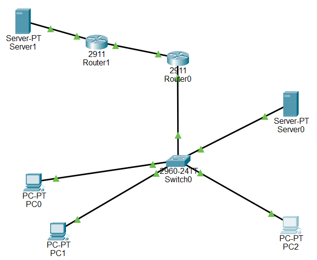
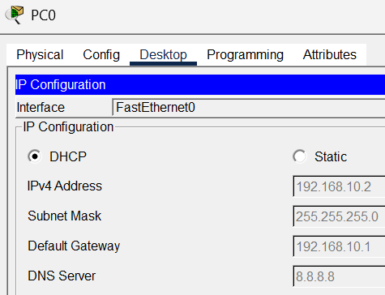
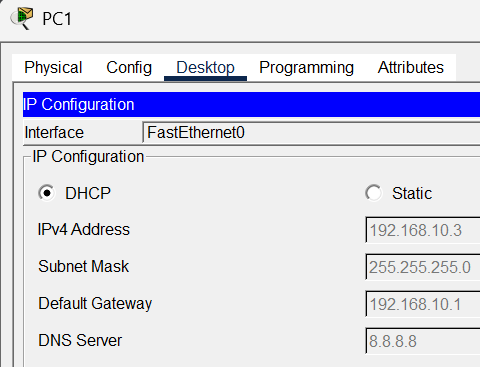
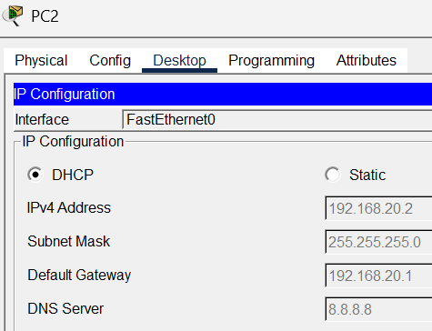
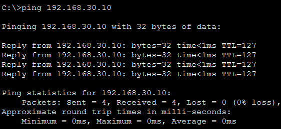
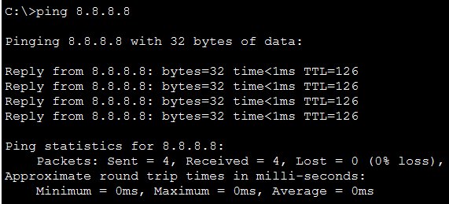
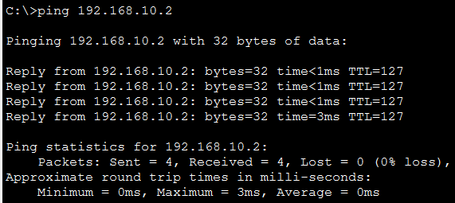
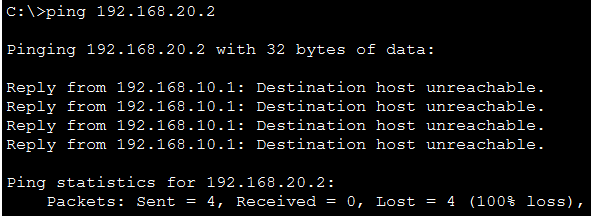
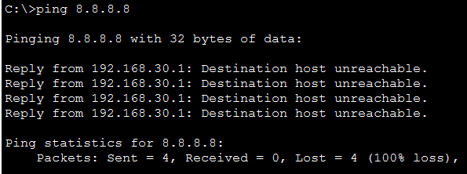

# Packet Tracer: Infraestructura de Red Corporativa, NAT Perimetral y Seguridad Asimétrica

<div align="justify">

Documentación técnica sobre el diseño, enrutamiento inter-VLAN, direccionamiento dinámico y políticas de control de acceso perimetral de una red empresarial segmentada lógicamente y con salida controlada hacia la WAN pública.

</div>

---

## Objetivo

<div align="justify">

Diseñar e implementar una arquitectura de red perimetral para fragmentar los dominios de difusión de la organización, automatizar la entrega de direccionamiento y desplegar un filtrado asimétrico que garantice el control total para el equipo de administración.

</div>

---

## 1. Diseño de la Arquitectura y Esquema Lógico

### Matriz de Direccionamiento e Inventario de IPs

<div align="justify">

La topología en estrella está segmentada en tres redes locales virtuales (LANs) y dos conexiones de área amplia (WAN) para simular la salida a Internet:

</div>

| Departamento / Red | ID de VLAN | Rango de Red / IP | Máscara de Red | Gateway (Router) | Tipo de Asignación |
| :--- | :---: | :--- | :---: | :--- | :--- |
| **USUARIOS** | 10 | `192.168.10.0/24` | `255.255.255.0` | `192.168.10.1` | Rango Dinámico |
| **PC0** | 10 | `192.168.10.2` | `255.255.255.0` | `192.168.10.1` | **DHCP** |
| **PC1** | 10 | `192.168.10.3` | `255.255.255.0` | `192.168.10.1` | **DHCP** |
| **ADMINISTRACIÓN** | 20 | `192.168.20.0/24` | `255.255.255.0` | `192.168.20.1` | Rango Dinámico |
| **PC2** | 20 | `192.168.20.2` | `255.255.255.0` | `192.168.20.1` | **DHCP** |
| **SERVIDORES** | 30 | `192.168.30.0/24` | `255.255.255.0` | `192.168.30.1` | Rango Estático |
| **Server0 (Local)** | 30 | `192.168.30.10` | `255.255.255.0` | `192.168.30.1` | **Estática (Fija)** |
| **Enlace Empresa - ISP** | N/A | `200.100.1.0/30` | `255.255.255.252` | N/A | Conexión Directa WAN |
| **Router0 (Interfaz Gi0/1)** | N/A | `200.100.1.2` | `255.255.255.252` | `200.100.1.1` | **Estática (Fija)** |
| **Internet Simulado** | N/A | `8.8.8.0/24` | `255.255.255.0` | `8.8.8.1` | Red Externa Pública |
| **Server1 (Web Ext.)** | N/A | `8.8.8.8` | `255.255.255.0` | `8.8.8.1` | **Estática (Fija)** |

### Matriz de Comunicación del Proyecto

* **Políticas Permitidas:** Administración (VLAN 20) mantiene visibilidad total (*Full IP Visibility*) sobre toda la red. Usuarios (VLAN 10) pueden comunicarse con los Servidores locales (VLAN 30) y navegar hacia la WAN.

* **Políticas Restringidas:** La red de Usuarios (VLAN 10) tiene denegado el acceso perimetral interno hacia la red de Administración (VLAN 20). **El servidor local (Server0) carece de acceso a Internet, quedando restringido estrictamente a las comunicaciones de la red local interna.**

### Esquema Visual de la Topología



---

## 2. Despliegue Técnico e Implementación de Seguridad

<div align="justify">
> **Historial de Configuración CLI:** El registro secuencial de comandos ejecutados en la consola de Cisco IOS se encuentra disponible en el archivo adjunto: [codigo_comandos.txt](./codigo_comandos.txt).
</div>

### A. Filtro de Seguridad Interna: Control Asimétrico (ACL Outbound)

<div align="justify">

Para conseguir que el Administrador tenga control de todo sin complicar la configuración del router, aplicamos una regla de acceso extendida justo en el camino de salida (<b>out</b>) hacia los usuarios (<code>Gi0/0.10</code>). El router solo revisa esta lista cuando va a entregar los datos a las PCs de los empleados. Gracias a esto, si el Administrador (VLAN 20) inicia un ping o una conexión web, el tráfico pasa limpio y recibe respuesta. En cambio, si un usuario intenta inventarse una conexión hacia la red de IT, el router intercepta el paquete al salir y lo destruye.

</div>

```router
Router0(config)# ip access-list extended Restricciones
Router0(config-ext-nacl)# deny ip any 192.168.20.0 0.0.0.255
Router0(config-ext-nacl)# permit ip any any
Router0(config-ext-nacl)# exit
Router0(config)# interface gigabitethernet0/0.10
Router0(config-subif)# ip access-group Restricciones out
```

---

### B. Bastionado del Segmento de Datos: Bloqueo WAN (ACL Inbound)

<div align="justify">

Siguiendo las buenas prácticas de protección de servidores (<i>hardening</i>), la zona de datos (VLAN 30) se aísla por completo. Como un servidor interno no necesita navegar por páginas web externas, ponemos una regla de control de entrada (<b>in</b>) en su subinterfaz (<code>Gi0/0.30</code>). Esta regla funciona como una lista blanca: solo deja pasar los paquetes que vayan dirigidos a las IPs privadas de la propia empresa (<code>192.168.0.0/16</code>). Al no haber ningún permiso para ir hacia el exterior, cualquier intento de salir a Internet es destruido en el acto, evitando robos de información o que un virus se conecte con el atacante.

</div>

```router
Router0(config)# ip access-list extended Restriccion_Servidor
Router0(config-ext-nacl)# permit ip 192.168.30.0 0.0.0.255 192.168.0.0 0.0.255.255
Router0(config-ext-nacl)# exit
Router0(config)# interface gigabitethernet0/0.30
Router0(config-subif)# ip access-group Restriccion_Servidor in
```

---

## 3. Pruebas de Validación y Auditoría del Entorno

### A. Validación del Servicio DHCP

<div align="justify">

Una vez montada la red, comprobamos que el reparto automático de IPs funciona bien. El router central actúa como servidor DHCP y le da a cada PC su dirección IP correcta según su VLAN, además de la máscara de red, la puerta de enlace (Gateway) y el DNS para navegar. Las capturas demuestran que cada equipo queda perfectamente separado en su rango:

</div>

* **PC0 (VLAN 10 - Red de Usuarios):**


  
* **PC1 (VLAN 10 - Red de Usuarios):**


  
* **PC2 (VLAN 20 - Red de Administración):**



---

### B. Validación de Canales Permitidos

<div align="justify">

Hicimos pruebas reales con la herramienta de ping (trazas ICMP) para confirmar que las conexiones necesarias de la oficina funcionan de forma fluida:

* <b>Acceso al Servidor de la Oficina:</b> Los usuarios (VLAN 10) llegan sin problemas al servidor local (<code>Server0</code>) en la VLAN 30, confirmando que el cable troncal que une el switch con el router funciona bien.



* <b>Salida a Internet:</b> Las PCs de los empleados salen a la red pública externa (<code>8.8.8.8</code>) sin problemas gracias a que el router camufla sus IPs privadas usando NAT PAT Overload.



* <b>Tareas de Soporte de IT:</b> La PC del Administrador (<code>PC2</code>) mantiene comunicación total y puede hacer ping hacia los usuarios para solucionar problemas técnicos, validando el diseño asimétrico.



</div>

---

### C. Validation de Canales Restringidos

<div align="justify">

Por último, forzamos pings prohibidos para comprobar que el router bloquea lo que tiene que bloquear:

</div>

<div align="justify">

* <b>Muro de seguridad hacia IT:</b> Si intentamos lanzar un ping desde el usuario <code>PC0</code> hacia el Administrador (<code>192.168.20.2</code>), el router frena los paquetes antes de entregarlos y la consola avisa con un error de <i>Destination host unreachable</i>.



* <b>Aislamiento de Internet en el Servidor:</b> Al intentar hacer un ping desde el <code>Server0</code> hacia la IP de Internet (<code>8.8.8.8</code>), la regla <code>Restriccion_Servidor</code> detecta que el paquete quiere salir de la empresa y lo destruye en el primer salto.



</div>

---

## 4. Análisis de Impacto ante Compromiso de Activos (Caso PC0 Infectado)

### A. Vector de Entrada y Riesgos Reales

<div align="justify">

* **Cómo se infecta la red:** Al dar salida libre a Internet a los usuarios (VLAN 10), el eslabón más débil es el factor humano. Si un empleado cae en un engaño de Phishing o descarga software de páginas no oficiales, el malware entrará directo a su PC de la oficina. El router actual no analiza el contenido de los archivos y procesará la descarga.

* **El peligro para los datos:** Como la red de usuarios necesita comunicarse de forma legítima con los servidores (VLAN 30) para poder trabajar, un virus en PC0 aprovecharía ese canal abierto. El atacante podría saltar al <code>Server0</code> para robar la base de datos de la empresa o cifrar los discos con un Ransomware para paralizar el negocio.

</div>

### B. Mecanismos de Defensa y Plan de Respuesta

<div align="justify">

* **Blindaje de la red de IT:** Si el atacante intenta escanear la red o saltar a la red de Administración (VLAN 20), la ACL de salida lo frena en seco. Los equipos de gestión de IT se mantienen totalmente aislados y a salvo.

* **Aislamiento en Capa 2:** Al estar separados por VLANs, ataques internos como intentar interceptar el tráfico local (<i>ARP Spoofing</i>) se quedan encerrados en la VLAN 10 sin poder afectar a los servidores ni a la administración.

* **Solución práctica del incidente:** En una situación real, la solución inmediata es desconectar la PC afectada apagando su puerto en el switch (<code>shutdown</code>). Después se auditan los accesos del servidor, se restauran copias de seguridad limpias (<i>backups</i>) y se aplican cursos de concienciación (<i>Security Awareness</i>) a la plantilla para evitar futuros descuidos.

</div>

---

## 5. Limitaciones del Diseño y Conclusiones

<div align="justify">

Esta infraestructura se ha diseñado como un escenario práctico para aplicar conceptos de redes, por lo que asume ciertas limitaciones lógicas antes de buscar un blindaje total:

1. **Infección en la red de Usuarios (VLAN 10):** El router del simulador hace un filtrado básico de paquetes, pero no analiza el contenido del tráfico web en tiempo real (Capa 7). La solución real para evitar que los usuarios bajen malware es sustituir este enrutador por un Firewall dedicado (Cisco ASA) e implementar la función de <i>Port Security</i> en el switch para que nadie conecte equipos no autorizados a los cables de la oficina.

2. **Infección en la red de IT (VLAN 20):** Si la máquina del Administrador se infecta saliendo a Internet, el atacante heredaría sus permisos totales y controlaría toda la empresa. Para evitarlo en entornos reales, se prohíbe que el equipo de IT navegue de forma libre (se usa un Proxy con listas blancas de páginas oficiales), se prohíbe usar cuentas de administrador para tareas comunes y se obliga a gestionar la red desde un servidor de salto aislado (<i>Bastion Host / Jump Box</i>) protegido con doble factor (MFA).

3. **Equilibrio entre Operatividad y Costes:** En una PYME real, bloquear Internet por completo o poner filtros extremos colapsaría el trabajo diario y aumentaría los costes de soporte. Este proyecto demuestra que se puede lograr un diseño equilibrado y eficiente: salida fluida con NAT para trabajar, aislamiento total para proteger los servidores de Internet y un muro estricto para cuidar el segmento de administración.

4. **Escalabilidad:** Como mejoras futuras para aumentar la seguridad, se plantea cambiar el router perimetral por un firewall dedicado (Cisco ASA) e implementar la función de <i>Port Security</i> en los puertos del switch. 

</div>

